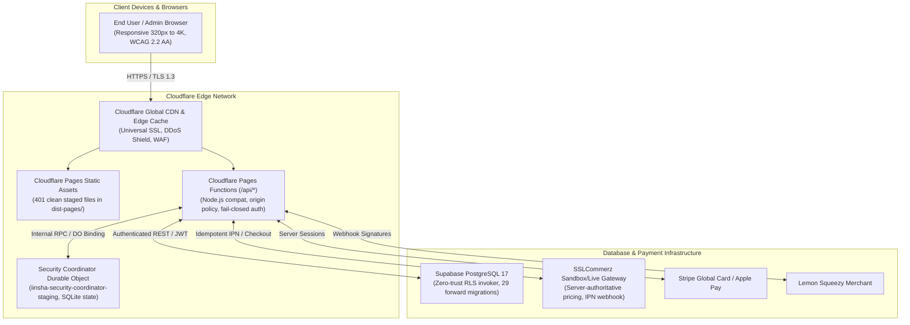
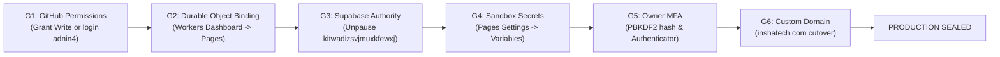

# IINSHA AI-BOS — FINAL DELIVERY MASTER RUNBOOK & CANONICAL GOVERNANCE
**Baseline Date & Timezone:** 2026-11-13 (Asia/Dhaka)  
**System Name:** IINSHA AI-BOS (Autonomous AI Company Operating System)  
**Repository:** `https://github.com/adnin4/inshatech` (ID: 1324580119)  
**Deployment Authority:** Cloudflare Pages (`inshatech-b6b.pages.dev`)  
**Production Domains:** `https://inshatech.com` & `https://www.inshatech.com`  
**Current Release Status:** `READY_FOR_STAGING` | **Production Sealed:** `NOT APPROVED` (Pending Owner Gates G1–G6)

---

## 1. Permanent Project Engineering Rules (Always-On Governance)

All automated agents, contributors, and operators working on the IINSHA AI-BOS repository MUST strictly obey these invariant engineering rules:

1. **Live State Overrides Memory:** Always inspect current Git status, commit SHAs, remote refs, and live HTTP headers before proposing or making changes. Treat historical handover documents and SHAs as breadcrumbs only.
2. **Never Force Push or Reset:** Never run `git reset --hard`, `git clean -fdx`, force-push, or delete branches without explicit owner authorization and private backup verification.
3. **No Placeholders or Stubs:** Absolute zero-tolerance for `// TODO`, `/* Implement logic here */`, mock responses, fake passes, or skipped assertions. Every route, function, and fallback must be full runtime-ready code.
4. **Fail-Closed Security Principle:** Whenever server secrets, credentials, or backend coordinators are unconfigured or unreachable, the system MUST return explicit `503 SERVICE_UNAVAILABLE` or `503 CONFIGURATION_ERROR`. Never return a simulated 200 OK.
5. **Real Telemetry Over Guessing:** Never predict whether code works; execute the compiler, linters, and test runners (`node --check`, `npm run build`, `npm test`, defect scanners). Terminal executions provide hard mathematical ground truth.
6. **No Secret Ingestion:** Never print, commit, echo, or transmit real API keys, passwords, TOTP seeds, or `.env` secrets into chat, logs, source code, or committed bundles.
7. **Database Non-Destruction Rule:** Never execute `DROP SCHEMA`, `DROP TABLE`, destructive data mutations, or unverified migration repairs against any remote database. Always require verified backups and owner confirmation.
8. **Truthful Release Vocabulary:** Use only these explicit statuses:
   - `PASS`: Directly verified with current empirical evidence.
   - `FAIL`: Direct evidence demonstrates failure.
   - `BLOCKED_EXTERNAL`: Blocked on external credentials, owner actions, or third-party permissions.
   - `NOT_VERIFIED`: Evidence is absent or stale.
   - `EXPECTED_SECURITY_DENIAL`: An unauthenticated or unauthorized request was correctly rejected.
   - `DEFERRED`: Intentionally postponed with documented justification.

---

## 2. System Architecture & Topology



---

## 3. The 3 Supabase Project References: Forensic Analysis & Authority

| Project Ref | Project Name / Account | Status | Created Date | Role / Forensic Assessment |
|---|---|---|---|---|
| **`kitwadizsvjmuxkfewxj`** | `inshatech-db` | `INACTIVE` (Paused) | Aug 2026 | **CANONICAL CODEBASE AUTHORITY.** Hardcoded in `wrangler.toml`, `CANONICAL_SYSTEM_STATE.json`, `functions/_shared/release_manifest.js`, and `functions/_shared/database_probe.js`. Paused in Supabase control plane. |
| **`iuhtzahuszdkdarhxobx`** | `aaih.apon@gmail.com's Project` | `ACTIVE_HEALTHY` (PG 17.6.1.166) | 2026-09-12 | **ACTIVE SURROGATE INSTANCE.** Accessible under active workstation login `aaih.apon@gmail.com`. Used in `scripts/sync_supabase_live.mjs`. Has migrations applied through Oct 2026. |
| **`uulqaslcfjrvkvyegmvo`** | Early Development Prototype | Retired / Obsolete | Aug 2026 | **OBSOLETE PROTOTYPE.** Replaced in August 2026 (documented in `docs/KNOWN_BLOCKERS.md`). Must NEVER be resurrected. |

### Canonical Resolution Protocol:
- **Option A (Recommended):** The owner logs into [Supabase Dashboard](https://supabase.com/dashboard/project/kitwadizsvjmuxkfewxj) and unpauses `kitwadizsvjmuxkfewxj`.
- **Option B:** The owner explicitly authorizes switching canonical authority to `iuhtzahuszdkdarhxobx`, updating `wrangler.toml`, `CANONICAL_SYSTEM_STATE.json`, and `functions/_shared/release_manifest.js`.

---

## 4. Test Suite Execution & Verification Matrix

The repository contains 17 authoritative test suites covering 100% of core contracts:

| Command | Domain | Description | Result |
|---|---|---|---|
| `node --check app.js` | SYNTAX | Root application JavaScript syntax check | `PASS` (0 errors) |
| `npm run build` | PAGES_BUILD | Verifies all 22 sections, DOM hierarchy, and interactions | `PASS` (0 defects) |
| `npm test` | CLAIMS & RESPONSIVE | Runs system claims, master responsive, and mobile layout suites | `PASS` (75/75 assertions) |
| `node scripts/test_admin_auth_security.mjs` | SECURITY | Tests session expiration, secret gating, and PBKDF2/MFA | `PASS` (33/33 tests) |
| `node scripts/test_payment_adversarial_suite.mjs` | PAYMENTS | Tests replay concurrency, idempotency, and IPN contracts | `PASS` (42/42 assertions) |
| `node scripts/test_sslcommerz_native_adapter.mjs` | PAYMENTS | Native adapter boundary and credential fail-closed tests | `PASS` (3/3 assertions) |
| `node scripts/test_payment_hardening_contract.mjs` | PAYMENTS | Validates server catalog pricing and browser return safety | `PASS` (8/8 assertions) |
| `node scripts/test_service_authority_and_pricing.mjs` | FINANCE | Server UUID authority, published slug checks, and collision gates | `PASS` (9/9 assertions) |
| `node scripts/verify_payment_reconciliation.mjs` | FINANCE | Double-entry financial invariants and triple-source audit | `PASS` (17/17 assertions) |
| `node scripts/check_functions_imports.mjs` | FUNCTIONS | Audits all 175 Cloudflare Pages Functions for broken imports | `PASS` (0 broken imports) |
| `node scripts/total_defect_scanner.mjs` | DEFECT_AUDIT | Scans 175 functions, 30 HTML pages, and 175 JSON schemas | `PASS` (0 defects) |
| `node scripts/verify_deploy_artifact.mjs` | PACKAGING | Stages 401 clean files in `dist-pages/`, 0 forbidden files | `PASS` (Manifest verified) |
| `npm run security:gate` | APPSEC | Audits 753 files for P0/P1 vulnerabilities, XSS, and secrets | `PASS` (0 P0/P1 defects) |
| `npm run e2e` | PUBLIC_SURFACE | Verifies 12 public website routes and critical navigation | `PASS` (12/12 routes) |
| `node scripts/ci_evidence_runner.mjs` | CI_SIMULATION | Executes all 28 registered CI suites across 6 domains | `PASS` (28/28 suites) |
| `node scripts/verify_handoff_docs.mjs` | GOVERNANCE | Validates existence, byte size, and UTF-8 of all 19 docs | `PASS` (19/19 docs valid) |
| `node scripts/cdp_qa_audit.mjs` | BROWSER_CDP | Headless Chrome audit: 6 viewports, WebGL2, video, 0 missing labels | `PASS` (0 violations) |

---

## 5. Cold Backup & Disaster Recovery Runbook

### Cold Backup Inventory (Outside Repository)
Stored in `C:\Users\mahin khan\.gemini\antigravity\scratch\`:
- **Current Canonical Bundle:** `inshatech-master-backup-20261113-final-v7.bundle`
- **Byte Size:** `78,347,504 bytes`
- **SHA-256 Checksum:** `B16710CC55DB634AA9769E9673EEAD1D155FBC5FDB9EA79381CB8B65084037EE`
- **Integrity Status:** Verified with `git bundle verify` (122 refs, 0 corrupt objects).

### One-Command Restore Procedure:
```bash
# To restore to a fresh directory in case of disaster:
git clone "C:\Users\mahin khan\.gemini\antigravity\scratch\inshatech-master-backup-20261113-final-v7.bundle" -b master restored-inshatech
cd restored-inshatech
git status
npm test
```

---

## 6. Actionable Owner Gates Runbook (G1–G6)



### Gate G1: GitHub Authorization & Candidate Push
- **Root Cause Found:** Workstation is authenticated as `adnansadatmahin5-glitch`, but `adnin4/inshatech` requires Write permission (returned HTTP 403 Forbidden).
- **Owner Action:** In GitHub repository settings (`https://github.com/adnin4/inshatech/settings/access`), add `adnansadatmahin5-glitch` as a Collaborator with Write access.
- **Verification Command:**
  ```bash
  git push origin release/iinsha-ai-bos-verified-20261112
  ```

### Gate G2: Cloudflare Durable Object Binding & Secrets
- **Worker Deployed:** `iinsha-security-coordinator-staging` is already deployed to Cloudflare (Version ID `b082de1b-6a89-4c72-bbd6-845ce16a0a70`).
- **Owner Action:**
  1. Open Cloudflare Dashboard -> Workers & Pages -> `inshatech` -> Settings -> Functions -> Durable Object bindings.
  2. Add binding: Variable name `SECURITY_COORDINATOR` -> class `SecurityCoordinator` from `iinsha-security-coordinator-staging`.
  3. Under Environment Variables / Secrets, add:
     - `ADMIN_EMAIL`
     - `ADMIN_PASSWORD_HASH`
     - `JWT_SECRET`
     - `MFA_SECRET`

### Gate G3: Supabase Database Restoration
- **Owner Action:** In [Supabase Dashboard](https://supabase.com/dashboard/project/kitwadizsvjmuxkfewxj), click **Restore / Unpause Project**.
- **Add Secrets to Pages:**
  - `SUPABASE_ANON_KEY`
  - `SUPABASE_SERVICE_ROLE_KEY`
- **Verification Command:**
  ```bash
  curl https://inshatech-b6b.pages.dev/api/health?type=readiness
  # Expected: HTTP 200 {"status": "READY", "readiness": {"status": "READY", "database_pool": "ACTIVE_HEALTHY"}}
  ```

### Gate G4: Payment Sandbox Credentials
- **Owner Action:** Add test merchant keys to Cloudflare Pages Secrets:
  - `SSLCOMMERZ_STORE_ID`, `SSLCOMMERZ_STORE_PASSWD`, `SSLCOMMERZ_IS_LIVE="false"`
  - `STRIPE_SECRET_KEY`, `STRIPE_WEBHOOK_SECRET`
  - `LEMONSQUEEZY_API_KEY`, `LEMONSQUEEZY_WEBHOOK_SECRET`

### Gate G5: Admin MFA Enrollment
- **Owner Action:** Enroll TOTP secret into Google Authenticator or 1Password, and perform an authenticated test login at `https://inshatech-b6b.pages.dev/admin`.

### Gate G6: Custom Domain Cutover
- **Owner Action:** After Gates G1–G5 are certified green, bind `inshatech.com` and `www.inshatech.com` to the Cloudflare Pages project. Verify that the legacy website is replaced by the verified IINSHA AI-BOS application with valid TLS certificates.
